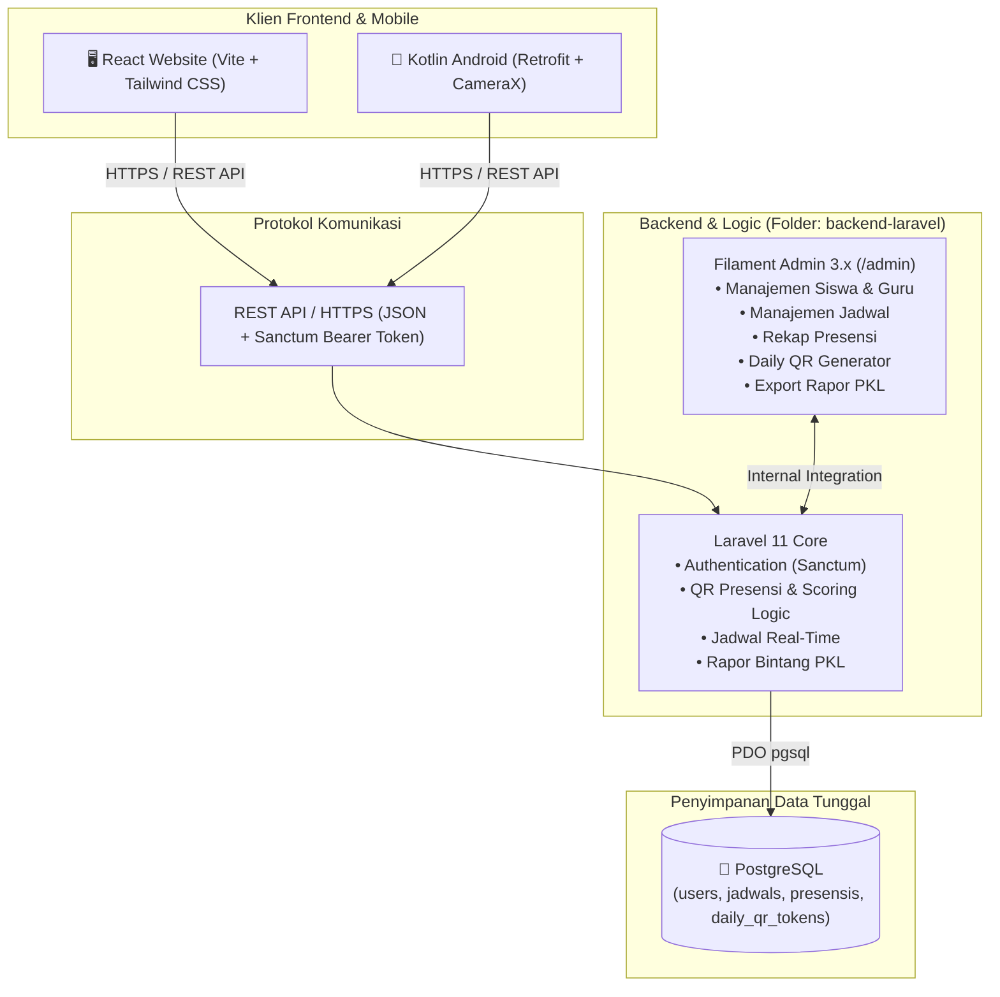

# ARCHITECTURE.md — Project-PSAS
**Sistem Informasi Presensi QR, Jadwal Pelajaran & Rapor PKL**

Proyek ini dibangun berdasarkan dua referensi utama:
1. **Desain UI/UX Figma**: [Project PSAS – Figma](https://www.figma.com/design/bONS1zMK0o0EBAbyWDY4mV/Project-PSAS?node-id=0-1&t=WYugzcHfuHMyhOlY-1)
2. **Arsitektur Sistem**: React Website & Kotlin Android terhubung melalui REST API / HTTPS ke Laravel + Filament Admin + PostgreSQL.

---

## 1. Diagram Arsitektur Sistem



---

## 2. Struktur Direktori Workspace

Workspace dipisahkan secara tegas ke dalam 3 folder utama di root (`d:/HADIR`):

```
d:/HADIR/
├── ARCHITECTURE.md             # Dokumen arsitektur dan spesifikasi API
├── backend-laravel/            # Backend Laravel 11, Filament Admin, REST API
│   ├── app/
│   │   ├── Filament/           # Filament Resources & Pages
│   │   │   ├── Resources/      # SiswaResource, GuruResource, JadwalResource, PresensiResource
│   │   │   └── Pages/          # DailyQrGenerator, RaporPklExport
│   │   ├── Http/Controllers/Api/ # Api/V1/ (AuthController, PresensiController, JadwalController, DashboardController)
│   │   └── Models/             # User, Jadwal, Presensi, DailyQrToken
│   ├── database/
│   │   ├── migrations/         # PostgreSQL DDL migrations
│   │   └── seeders/            # DatabaseSeeder (Admin, Guru, Siswa, Jadwal demo)
│   ├── routes/
│   │   ├── api.php             # /api/v1/...
│   │   └── web.php             # Web & Filament routes
│   └── composer.json
├── frontend-web/               # React (Vite + Tailwind CSS + Lucide Icons)
│   ├── src/
│   │   ├── components/         # Navbar, ScanModal
│   │   ├── pages/              # LoginPage, DashboardSiswa, JadwalPage, MonitoringGuruPage
│   │   ├── services/           # api.js (Axios client with Sanctum interceptor)
│   │   └── App.jsx
│   └── package.json
└── mobile-android/             # Android Kotlin (Retrofit, CameraX / MLKit QR, ViewPager2)
    ├── app/src/main/
    │   ├── java/com/psas/hadir/
    │   │   ├── data/api/       # ApiService, RetrofitClient, AuthInterceptor
    │   │   ├── data/model/     # ApiModels (Login, User, Dashboard, Jadwal, Scan, Monitoring)
    │   │   ├── utils/          # SessionManager, ScheduleTimeUtils (centang hijau real-time)
    │   │   └── ui/             # LoginActivity, MainActivity, JadwalActivity, ScannerActivity, MonitoringActivity, Adapters
    │   └── res/
    │       ├── layout/         # UI layouts sesuai Figma
    │       ├── drawable/       # Vector icons & gradient shapes
    │       └── values/         # colors, strings, themes
    └── build.gradle.kts
```

---

## 3. Skema Database (PostgreSQL)

### A. Tabel `users`
| Kolom | Tipe Data | Keterangan |
| :--- | :--- | :--- |
| `id` | BIGSERIAL | Primary Key |
| `nis_nip` | VARCHAR(50) | UNIQUE, NIS (Siswa) atau NIP (Guru/Admin) |
| `nama_lengkap` | VARCHAR(150) | Nama lengkap pengguna |
| `kelas` | VARCHAR(20) | Nullable (diisi untuk Siswa, misal: `XII RPL 1`) |
| `role` | VARCHAR(20) | Enum: `'siswa'`, `'guru'`, `'admin'` |
| `password` | VARCHAR(255) | Hash Bcrypt |
| `poin_kedisiplinan` | INTEGER | Default `100` |
| `bintang` | NUMERIC(2,1) | Default `5.0` |
| `created_at` / `updated_at` | TIMESTAMP | Standar Laravel timestamps |

### B. Tabel `jadwals`
| Kolom | Tipe Data | Keterangan |
| :--- | :--- | :--- |
| `id` | BIGSERIAL | Primary Key |
| `kelas` | VARCHAR(20) | Kelas target (misal: `XII RPL 1`) |
| `hari` | VARCHAR(15) | Enum: `'Senin'`, `'Selasa'`, `'Rabu'`, `'Kamis'`, `'Jumat'` |
| `nama_kegiatan` | VARCHAR(150) | Nama mata pelajaran atau kegiatan |
| `nama_guru` | VARCHAR(150) | Nama guru pengajar |
| `jam_mulai` | TIME | Format: `HH:MM:SS` (contoh `07:15:00`) |
| `jam_selesai` | TIME | Format: `HH:MM:SS` (contoh `08:45:00`) |
| `created_at` / `updated_at` | TIMESTAMP | Standar Laravel timestamps |

### C. Tabel `presensis`
| Kolom | Tipe Data | Keterangan |
| :--- | :--- | :--- |
| `id` | BIGSERIAL | Primary Key |
| `user_id` | BIGINT (FK) | Relasi ke `users.id` (onDelete CASCADE) |
| `tanggal` | DATE | Tanggal presensi (format `YYYY-MM-DD`) |
| `jam_datang` | TIME | Jam scan pertama (nullable) |
| `jam_pulang` | TIME | Jam scan kedua/pulang (nullable) |
| `status` | VARCHAR(30) | Enum: `'Tepat Waktu'`, `'Terlambat'` |
| `poin_perubahan` | INTEGER | `0` (Tepat Waktu) atau `-5` (Terlambat) |
| `created_at` / `updated_at` | TIMESTAMP | Standar Laravel timestamps |

### D. Tabel `daily_qr_tokens`
| Kolom | Tipe Data | Keterangan |
| :--- | :--- | :--- |
| `id` | BIGSERIAL | Primary Key |
| `tanggal` | DATE | UNIQUE, tanggal berlaku QR |
| `token` | VARCHAR(64) | Token acak/hash unik harian |
| `jam_mulai` | TIME | Jam mulai scan dapat diterima (default `06:00:00`) |
| `jam_selesai` | TIME | Jam akhir scan presensi (default `17:00:00`) |
| `created_at` / `updated_at` | TIMESTAMP | Standar Laravel timestamps |

---

## 4. Business Logic & Aturan Penilaian

1. **Aturan Presensi Datang**:
   - Batas jam tepat waktu: **07:00 WIB**.
   - Scan dilakukan sebelum atau sama dengan **07:00:00 WIB** $\rightarrow$ Status: `Tepat Waktu`, `poin_perubahan = 0`, poin kedisiplinan tetap.
   - Scan dilakukan setelah **07:00:00 WIB** $\rightarrow$ Status: `Terlambat`, `poin_perubahan = -5`.
2. **Kalkulasi Nilai Bintang Kedisiplinan PKL**:
   - $Poin = Poin_{lama} - 5$
   - Konversi skor ke rating bintang:
     - $95 \le Poin \le 100 \rightarrow \mathbf{5.0 \star}$
     - $85 \le Poin \le 94 \rightarrow \mathbf{4.0 \star}$
     - $75 \le Poin \le 84 \rightarrow \mathbf{3.0 \star}$
     - $Poin < 75 \rightarrow \mathbf{2.0 \star}$
3. **Jadwal Real-Time**:
   - Pada hari Sabtu & Minggu: Response mengembalikan flag `is_weekend = true` dengan pesan ramah akhir pekan.
   - Pada hari Senin–Jumat: Response menandai status real-time untuk setiap sesi (`completed` jika jam telah lewat $\rightarrow$ centang hijau di UI, `ongoing` jika saat ini berlangsung, `upcoming` jika belum dimulai).

---

## 5. Spesifikasi Kontrak REST API (`/api/v1`)

| Method | Endpoint | Auth | Deskripsi |
| :--- | :--- | :--- | :--- |
| `POST` | `/api/v1/login` | Publik | Login dengan `nis_nip` & `password`. Menghasilkan Sanctum token. |
| `POST` | `/api/v1/logout` | Bearer | Revoke token aktif pengguna. |
| `GET` | `/api/v1/user` | Bearer | Detail profil pengguna aktif. |
| `GET` | `/api/v1/dashboard` | Bearer (Siswa) | Ringkasan kehadiran hari ini, sisa poin, bintang, & jadwal hari ini. |
| `POST` | `/api/v1/presensi/scan` | Bearer (Siswa) | Validasi payload QR token harian + catat jam datang/pulang + kalkulasi poin. |
| `GET` | `/api/v1/presensi/today` | Bearer (Siswa) | Mengecek status kehadiran siswa untuk hari ini. |
| `GET` | `/api/v1/jadwal` | Bearer | Mengambil jadwal pelajaran kelas siswa/guru (Senin–Jumat). |
| `GET` | `/api/v1/guru/monitoring` | Bearer (Guru/Admin) | Rekap kehadiran seluruh siswa, filter kelas, dan rapor bintang PKL. |

---

## 6. Panel Admin (Filament Admin)

Terintegrasi langsung di `/admin`:
- **Dashboard Overview**: Metrik kehadiran harian, statistik keterlambatan, dan distribusi bintang PKL.
- **Siswa Resource**: CRUD data siswa, reset poin, ubah kelas.
- **Guru Resource**: CRUD data staf guru dan mata pelajaran.
- **Jadwal Resource**: Manajemen jadwal pelajaran per kelas dan per hari.
- **Presensi Resource**: Monitor log kehadiran real-time per tanggal dan status.
- **Daily QR Generator Page**: Generate atau tampilkan kode QR presensi harian untuk proyektor/layar sekolah.
- **Export Rapor PKL**: Cetak/Download rekap rapor kedisiplinan siswa (PDF / Excel / CSV).
